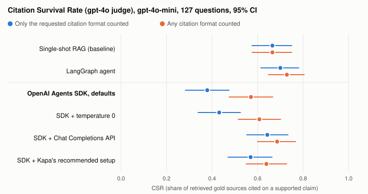

# Citation Survival Rate (CSR): Do Citations Survive the MCP Tool Boundary?

**A benchmark measuring what happens to source attribution when a RAG knowledge base is consumed
by an AI agent over MCP instead of a single-shot retrieval call. It separates whether an agent
cites its sources from whether it cites them in the format it was asked for, validates the metric
against blind human judgement, and tests a guardrail that adds missing citations back.**

> **Headline.** With the same model (gpt-4o-mini), corpus, questions and system prompt, an agent
> built with the **OpenAI Agents SDK** ignores the requested citation format in **51 of 127
> answers** (40%), citing with Markdown links `[text](url)` instead of the `[url]` the prompt asks
> for. Single-shot RAG does this in 0 answers, a LangGraph agent in 8.
>
> **Does it lose citations?** Somewhat, but most of the apparent loss is format. Counting only the
> requested format, CSR drops by about 0.30. Counting **any** link format, three runs per setup
> show a smaller loss that holds in every run and under both scorers: **−0.12** (original scorer)
> and **−0.09** (gpt-4o judge). At temperature 0 no loss is detectable.
>
> **Cause of the format drift.** The API the SDK calls by default. Switching the same agent from
> OpenAI's Responses API to Chat Completions cuts wrong-format answers from 41 to 9. Kapa's
> recommended prompt setup cuts them to 20.
>
> **A fix the retrieval server controls.** If the server tags each chunk with a short source ID
> (`[S3fa21c]`) and IDs are mapped back to URLs after the answer is written, wrong-format answers
> fall from about 50 to about 5 per run, the SDK agent's CSR rises by 0.10–0.13, and its gap to
> single-shot closes. (Pre-registered; 3 runs each; see [Source IDs](#source-ids-at-the-tool-contract-guardrail-v3a).)
>
> **Corrections.** 2026-10-14: an earlier version reported the −0.31 as lost citations ("66 of
> 127 answers cite nothing"). That counted only `[url]`; of those 66 answers, 51 cite with Markdown
> links and only 8 contain no URL at all. Both views are now reported. 2026-10-16: the version
> after that said a citation loss was "not established" from one run; three runs per setup show a
> smaller loss is real (above).



---

## The problem

Retrieval-augmented generation systems are judged on whether their *answers* are correct. But a
documentation assistant that is right and uncited is not much use: you cannot verify it, and you
cannot click through to the source.

The Model Context Protocol (MCP) makes this concrete. An MCP retrieval server hands
`{source_url, content}` chunks to an agent it does not control, and the agent writes the final
answer. The server's accuracy guarantees stop at that boundary. **What happens to attribution on
the other side of it is unmeasured.** This project measures it.

---

## What CSR measures

For every atomic claim in an answer, with its cited `source_url`s, two checks:

1. **Support check (ALCE-style):** does the cited chunk *support* the claim?
2. **Trace-grounding check:** was the cited URL *actually retrieved* by the agent, according to
   the logged tool-call trace?

> **CSR** = of the gold source URLs the agent **actually retrieved**, the fraction that end up in
> the final answer cited on a claim the chunk genuinely supports.

Conditioning on what was retrieved isolates *attribution* failure from *retrieval* failure. CSR is
`None` (not zero) when the agent retrieved no gold URL.

**Two views of "cited".** *Requested format:* only `[url]`, the format the prompt asks for (for
Kapa's setup, its `[[title](url)]`). This measures compliance as much as attribution. *Any
format:* `[url]`, Markdown links `[text](url)` and Kapa brackets all count (bare URLs in running
text do not). This measures whether sources are cited at all. The rule was fixed before re-scoring
(decision log, 2026-10-14).

The support check is run two ways: the original scorer (`cross-encoder/nli-deberta-v3-base`,
argmax = entailment) and a gpt-4o judge chosen against human labels (same rubric as the human
labellers). A Claude judge cross-checks the requested-format view. See
[Is CSR trustworthy?](#is-csr-trustworthy).

---

## Results

127 human-verified FastAPI documentation questions (82 single-source, 29 multi-source,
16 unanswerable). Bootstrap 95% CIs, 10,000 resamples. Full table: `results/anyformat_report.txt`.

| Pipeline | Model | Requested format, original scorer | Requested format, gpt-4o judge | **Any format, original scorer** | **Any format, gpt-4o judge** |
|---|---|---|---|---|---|
| Single-shot RAG | gpt-4o-mini | 0.618 | 0.665 | 0.618 | 0.665 |
| LangGraph agent | gpt-4o-mini | 0.614 | 0.700 | 0.643 | 0.729 |
| **OpenAI Agents SDK** | gpt-4o-mini | 0.323 | 0.379 | **0.470** | **0.571** |
| Single-shot RAG | claude-sonnet-4-6 | 0.774 | 0.887 | 0.774 | 0.887 |
| LangGraph agent | claude-sonnet-4-6 | 0.710 | 0.804 | 0.710 | 0.804 |

The OpenAI Agents SDK × Claude combination was not run.

### Which differences are real

Every pipeline answers the *same* questions, so the test resamples the **per-question
difference** (paired bootstrap).

| Comparison | Requested format (original / judge) | **Any format (original / judge)** | Verdict |
|---|---|---|---|
| OpenAI Agents SDK − single-shot | −0.311 / −0.296, both real | **−0.163 real / −0.102 n.s.** | Real format gap; citation gap: see three runs below (robust) |
| SDK at temperature 0 − single-shot | −0.207 / −0.227, both real | **−0.056 / −0.045, both n.s.** | No citation gap |
| LangGraph − single-shot (gpt-4o-mini) | +0.000 / +0.029, n.s. | +0.029 / +0.059, n.s. | No difference |
| LangGraph − single-shot (Claude) | −0.077 n.s. / −0.096 real | −0.077 n.s. / −0.096 real | Not established |

### Three runs per setup

The table above is one run per setup, so its intervals cover question sampling but not
run-to-run variation. Each gpt-4o-mini setup was run twice more with fresh generations (decision
rule fixed in advance: a difference is robust only if it has the same sign in all three runs and
the pooled paired interval excludes zero). Full output: `results/repeats_report.txt`.

| Comparison (any format) | Runs 1 / 2 / 3, original scorer | Pooled, original scorer | Pooled, gpt-4o judge | Verdict |
|---|---|---|---|---|
| OpenAI Agents SDK − single-shot | −0.163 / −0.143 / −0.055 | **−0.120** [−0.209, −0.030] | **−0.086** [−0.164, −0.005] | Robust under both |
| SDK at temperature 0 − single-shot | −0.056 / −0.100 / −0.051 | −0.066 [−0.160, +0.028] | −0.045 [−0.130, +0.043] | No detectable loss |
| LangGraph − single-shot | +0.029 / +0.000 / +0.044 | +0.023 [−0.062, +0.105] | +0.037 [−0.036, +0.110] | No difference |

In the requested-format view the SDK gap is −0.302 [−0.394, −0.210], so about 60% of the
apparent loss is format and about 40% is real: retrieved sources left uncited, or cited only on
claims they don't support (original scorer, the only one run on both views in all three runs). The per-run any-format gap
ranges from −0.05 to −0.16, which is why one run could not settle it.

---

## Citation format: what the SDK changes

Each answer counted once, no scorer involved (`results/format_compliance.txt`):

| Run (gpt-4o-mini) | Cites in the requested format | **Cites only in another link format** | Bare URLs only | No URL |
|---|---|---|---|---|
| Single-shot RAG | 108 | **0** | 0 | 19 |
| LangGraph agent | 112 | **8** | 1 | 6 |
| OpenAI Agents SDK, defaults | 61 | **51** | 7 | 8 |
| SDK + temperature 0 | 73 | **41** | 2 | 11 |
| SDK + Kapa's recommended tool description | 73 | **41** | 2 | 11 |
| SDK + Chat Completions API | 109 | **9** | 0 | 9 |
| SDK + Kapa's recommended setup (asks for `[[title](url)]`) | 84 | **20** | 6 | 17 |

Across three runs, "cites only in another link format" was 0 / 0 / 0 for single-shot, 8 / 12 / 9
for LangGraph and 51 / 53 / 46 for the SDK's defaults; Chat Completions (9 / 12 / 15) and Kapa's
setup (20 / 23 / 16) cut it in every run, while temperature 0 alone does not (41 / 60 / 60).

The SDK runs come from a pre-registered ablation (one change at a time; plan and criterion written
before running). What it shows:

- **The format drift tracks the API, not the loop or the temperature.** The SDK calls OpenAI's
  Responses API by default; on Chat Completions (what the LangGraph agent uses) wrong-format
  answers fall from 41 to 9.
- **The sources are not lost in transport.** Logging exactly what the model receives shows every
  chunk arrives with its `source_url` intact, and the Markdown links point to retrieved pages
  (98 of 118 in the default run).
- **Kapa's guidance** ([Prompt for grounded answers](https://docs.kapa.ai/retrieval/guides/prompt-your-agent))
  helps compliance when followed in full (41 → 20 wrong-format answers); their tool description
  alone changes nothing, consistent with that page putting citation rules in the system prompt.
- **In the published run, none of these changes altered whether sources are cited.** Counting any
  format, E3 vs E1 is +0.020 / +0.069 and E4 vs E1 +0.030 / +0.035, all not significant. (Counting only the requested
  format they were +0.108 / +0.201 and +0.111 / +0.136, all significant: that was format.)
- Why it matters: anything downstream that parses, renders or verifies citations by format (a
  citation UI, a guardrail, an evaluation) silently loses them when the agent ignores the format.

Caveat: the ablation comparisons above are from the published run of each setup; the format
counts were repeated (above), the E3/E4 CSR comparisons were not tested across runs.

---

## Is CSR trustworthy?

1. **Which support checker agrees with humans?** 115 human judgements of "does this chunk support
   this sentence?" (`results/verifier_bench.txt`). On the 65-item held-out set: original DeBERTa
   scorer κ 0.24 on raw text; MiniCheck-Flan-T5 on cleaned prose κ 0.63 (0.67 with a code-symbol
   check); Claude judge κ 0.63; **gpt-4o judge κ 0.86** (precision 0.95, recall 0.95). Cleaning
   Markdown and code out of the input helps every model. Caveat: every pair was one DeBERTa had
   accepted when sampled, so this measures how well each checker rejects DeBERTa's false positives.
2. **Does a result depend on the checker?** Some do, and this README says which. The judges find
   more support than DeBERTa in every pipeline, so absolute CSR depends on the scorer. All scorers
   share one citation parser, so agreement between scorers says nothing about citation *format*;
   that is why both format views are reported.
3. **Does CSR agree with a human?** 30 gold sources, 6 per pipeline, judged "did this source
   survive, correctly cited?" (`results/csr_validation_report.txt`): agreement **25/30** (original
   scorer, κ 0.64), **27/30** (gpt-4o judge, κ 0.77), **26/30** (Claude judge, κ 0.70). Errors run
   mostly one way: scorers miss support a human sees. Caveat: on 2 of the 30 (both OpenAI SDK),
   the labelling page showed "never cites the gold source" because it recognised only `[url]`,
   though the source was cited as a Markdown link; human and scorers agree there for the wrong
   reason.

---

## The guardrail

Post-processing middleware at the boundary a retrieval provider controls: it adds citations to
uncited sentences in a third-party agent's answer. **It never rewrites a word**:
`assert_only_citations_added()` checks that, after stripping citations and whitespace, the answer
is byte-identical, on every answer of every run.

| | v1 (naive) | v2 |
|---|---|---|
| Method | NLI on raw sentences vs every retrieved chunk; cite every hit | Prose only (code/Markdown stripped) → atomic claims → cleaned chunks → every claim entailed with P ≥ 0.9 (fixed before any held-out label) → cite the single best chunk |
| Citations added, 5 pipelines | 1,582 | 357 |
| CSR lift, OpenAI Agents SDK (original scorer, requested format)* | +0.222 | +0.146 [+0.066, +0.227] |
| **Human-judged precision, blind** | **15/50 = 30%** | **39/50 = 78%** [65, 87] on a held-out sample |
| Precision on gold-source citations | 8/13 | 22/24 |

\* Measured in the requested-format view: some of what the guardrail "recovers" on the SDK were
sentences already cited with Markdown links. The human-judged precision is unaffected.

- **v1 fooled its own scorer.** The same NLI model inserted citations and graded them, rating its
  mostly-wrong insertions as precise; only the blind audit exposed it. Cause: raw Markdown (code
  blocks, `2. **Title**:` headings) and HTML-laden chunks produce confident false entailments
  (removing one bold heading moved P(entailment) from 0.997 to 0.000).
- **v2** was evaluated on a fresh sample committed before labelling (50 inserted + 15 it
  rejected, mixed blind): of what it rejected, only 4/15 were correct, so the threshold rejects
  the right things. A second rater (Claude, independently) agreed with the human on 54/65 (κ 0.68).
- v2 still misses the ≥ 90% precision bar, which led to moving citations to the tool contract:

### Source IDs at the tool contract (guardrail v3a)

Instead of repairing answers afterwards, the server prevents the drift. With
`CSR_SOURCE_IDS=1`, every chunk carries a short, stable ID (`S` + 6 hex characters of a hash of its
URL); the tool description and the agent prompt ask for `[ID]` citations; and
`guardrail/map_source_ids.py` maps each ID back to its URL after the answer is written, accepting
only IDs from that answer's own retrieved chunks (so a made-up ID is not a citation).
Pre-registered (decision log, 2026-10-16), 3 runs on each agent:

| | SDK defaults | **SDK + source IDs** | LangGraph | **LangGraph + source IDs** |
|---|---|---|---|---|
| Wrong-format answers, runs 1 / 2 / 3 | 51 / 53 / 46 | **5 / 5 / 4** | 8 / 12 / 9 | **0 / 1 / 5** |
| Any-format CSR, original scorer (mean of 3) | 0.491 | **0.587** | 0.634 | **0.688** |
| Any-format CSR, gpt-4o judge (mean of 3) | 0.597 | **0.721** | 0.719 | **0.771** |

- **Format drift almost disappears**, and not by citing less (answers with no citation: 11 / 12 / 11
  with IDs vs 8 / 10 / 14 without).
- **Citation presence improves too:** +0.096 [+0.028, +0.163] (original scorer) and +0.125
  [+0.064, +0.186] (judge) over the SDK's defaults, robust in every run. With IDs the SDK agent is
  indistinguishable from single-shot (−0.028 / +0.042, n.s.). LangGraph gains +0.064 / +0.059.
- **IDs are copied reliably:** 1,575 mapped, 2 unresolvable, 16 written outside brackets (not
  counted). Mapping costs about 0.02 ms per answer, no model calls.
- Caveats: it changes the tool output and the citation instruction together; support is measured
  by the scorers, and no human audit of v3a's citations has been done yet.

Run it: `uv run python -m guardrail.run_guardrail --guardrail v2 --input … --output …`
(`--guardrail v1` is the default and reproduces the v1 numbers).

---

## Using this against Kapa's hosted MCP server

The local server mirrors Kapa's `search_<product>_knowledge_sources` contract (`{source_url,
content}`, Markdown content, streamable HTTP, `top_k`/`max_chars` defaults). Every pipeline reads
its server from `.env` (`pipelines/mcp_config.py`), so pointing the benchmark at a real Kapa project
is a settings change:

```bash
MCP_SERVER_URL=https://<subdomain>.mcp.kapa.ai
MCP_SERVER_AUTH_TOKEN=<your Kapa API key>          # sent as "Authorization: Bearer <key>"
MCP_SEARCH_TOOL=search_<product>_knowledge_sources
```

Tested: with these set, all three pipelines send the bearer header and report a clear error on a
refused key; with them blank, they reproduce the published runs against the local mirror.
**Not yet done:** an actual run against Kapa's production server (no access so far), so whether
its results come back in the same shape is unverified. Two things do not carry over: the 127
questions and gold URLs are FastAPI-specific, so a real project needs its own hand-verified set
(the metric, scorers and harness are unchanged), and the guardrail and scorers assume the
`[source_url]` citation format.

---

## Reproducing

```bash
git clone <repo-url> && cd csr-mcp-benchmark
uv sync                                   # Python 3.12+, all versions pinned
cp .env.example .env                      # add OPENAI_API_KEY; AWS creds for the Claude arms

uv run pytest guardrail/ measure/ pipelines/ -q   # 45 tests, no API keys needed

# Rebuild the original-scorer numbers from the committed raw model outputs:
bash scripts/overnight_rebuild.sh
```

| What | Command |
|---|---|
| Guardrail v2 on all pipelines, v1 vs v2 table | `bash scripts/run_guardrail_v2_all.sh` then `uv run python -m measure.guardrail_v2_compare` |
| SDK ablation (generates new answers, ~$5 of API calls) | `bash scripts/run_sdk_ablation.sh` then `uv run python -m measure.sdk_ablation_report` |
| Verifier benchmark vs human labels | `uv run python -m measure.verifier_bench` |
| Re-score with an LLM judge | `uv run python -m measure.rescore_judge --judge gpt-4o` (or `claude`), then `uv run python -m measure.rescore_compare --judge gpt-4o` |
| CSR vs human | `uv run python -m measure.csr_validation_report` |
| Any-format re-score (both views) | `bash scripts/run_anyformat_rescore.sh` (report: `uv run python -m measure.anyformat_report`) |
| Citation format per answer | `uv run python -m measure.format_compliance` |
| Repeat runs + source IDs (generates 18 runs, ~$20 of API calls) | `bash scripts/run_repeats_and_v3a.sh` then `uv run python -m measure.repeats_report` |
| Chart | `uv run python -m measure.make_charts` |

Every number in this README is reproducible from `results/`. LLM and NLI outputs are cached by
SHA-256 of their inputs, so re-scoring is deterministic and cheap once the cache is warm.

---

## How it is built

| Layer | Choice | Why |
|---|---|---|
| Corpus | FastAPI docs, raw Markdown from GitHub | Clean Markdown, stable public URLs, well-bounded |
| Chunking | Heading-aware recursive, with parent-heading breadcrumbs (2,085 chunks from 153 pages) | Each chunk stays a coherent, citable unit |
| Embeddings | `text-embedding-3-small`, persisted to Chroma | Simple, consistent with the OpenAI provider |
| Retrieval server | FastMCP, streamable HTTP | Mirrors a hosted MCP `search_<product>_knowledge_sources` contract |
| Pipelines | Single-shot · LangGraph ReAct · OpenAI Agents SDK | Same system prompt across pipelines |
| Original scorer | `cross-encoder/nli-deberta-v3-base`, argmax = entailment | Fast and local; kept as the reference |
| LLM judges | gpt-4o, Claude Sonnet 4.6, one fixed rubric, temperature 0 | Chosen against human labels; used as independent scorers |
| Claim decomposition | gpt-4o-mini, temperature 0, cached | FActScore-style; identical for every pipeline and scorer |

All dependency versions are pinned and `uv.lock` is committed.

---

## Honest limitations

- **One corpus, small sample.** 127 FastAPI questions (29 multi-source), each gold attribution
  verified by hand. Every number carries a confidence interval, and nulls are stated as nulls.
- **Runs.** Three runs per gpt-4o-mini setup (fresh generations; the SDK offers no seed). The
  Claude arms and the E2 ablation were run once.
- **Two models, partial matrix.** gpt-4o-mini and Claude Sonnet 4.6; the OpenAI SDK × Claude
  combination was not run.
- **Absolute CSR depends on the scorer.** The LLM judges score 0.03–0.11 higher than the original
  scorer. The citation-format and LangGraph conclusions hold under every scorer; the SDK's
  any-format gap held under only one scorer in a single run, and under both once pooled over three
  runs.
- **Format vs presence.** CSR as first defined counted only the requested `[url]` format. Both
  views are now reported; bare URLs in running text are still not counted.
- **Judges and models share families.** The gpt-4o judge scores gpt-4o-mini answers. On the
  requested-format view it is cross-checked by a Claude judge (which scores the Claude pipelines
  *lower* than the gpt-4o judge does); the any-format view has no Claude cross-check yet.
- **Human checks are small.** 115 citation labels and 30 CSR units, mostly from one annotator,
  with an independent second rater (Claude) on 115 of them.
- **Self-hosted mirror.** This measures a local server implementing a published MCP contract, not
  Kapa's or anyone's production system.
- **NLI context window.** The original scorer truncates at 512 tokens; this likely explains part of
  why it finds less support than the judges.

---

## Engineering notes

The project was audited end to end before publication, as a hostile reviewer would. That found
**five bugs**, four of which would otherwise have shipped: a guardrail sentence splitter that cited
bare Markdown list markers (21% of insertions); a fabricated-citation counter that was 3–7× too
high; `ChatBedrock` silently defaulting to `max_tokens=1024`, truncating 52/127 answers in one arm;
an audit sampler that reverse-engineered decisions instead of recording them; and silent NLI
premise truncation. One of our own hypotheses was disproved: fixing the truncation did not erase
the Claude LangGraph drop (0.718 → 0.710).

Later checks found three more issues, reported above rather than hidden: the guardrail v1
circularity (exposed by a blind human audit); an unset temperature in the SDK pipeline (tested
directly); and, most consequential, a citation parser that counted only the requested `[url]`
format, which had turned format drift into apparent citation loss (found by reading the raw
answers, corrected 2026-10-14).

---

## Repository layout

```
ingest/      corpus download, heading-aware chunking, embedding, Chroma index
server/      MCP retrieval server (streamable HTTP); opt-in Kapa tool description for ablations
eval_set/    127 human-verified Q&A pairs with gold source URLs
pipelines/   baseline · langgraph_agent · openai_agent (+ provider strategy layer, ablation flags)
measure/     scorer, LLM-judge re-scoring, verifier benchmark, CIs, paired tests, reports, chart
guardrail/   attribution middleware v1 and v2 + tests
results/     every published number, per-question traces, human labels, figures
scripts/     rebuild, guardrail v2 run, SDK ablation, labelling-page builder
```

---

## Background

Builds on **ALCE** (citation precision/recall via entailment) and **FActScore** (atomic claim
decomposition). Takes the *concept* from Wallat et al., that a correct answer is not the same as a
faithful one, while substituting a cheap trace-grounding check for their counterfactual
regeneration method. MiniCheck (Tang et al., 2024) is re-implemented from its official code for
the verifier benchmark.
